

  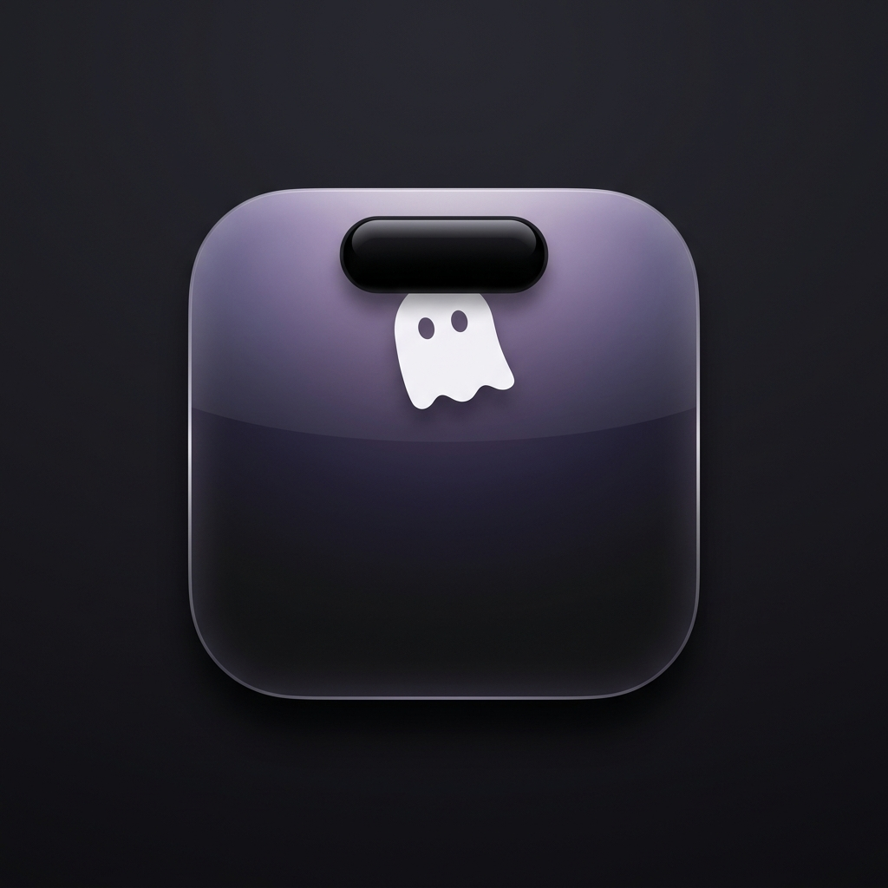

<h1 align="center">figghost</h1>

  A light, native toolbox for the menu bar and the notch of your Mac. 
  Smooth scrolling, clipboard history, window snapping, Vietnamese typing, per-app sound, screenshots and a notch with a tab for every small tool.

  
  

  
  
  
  
  

  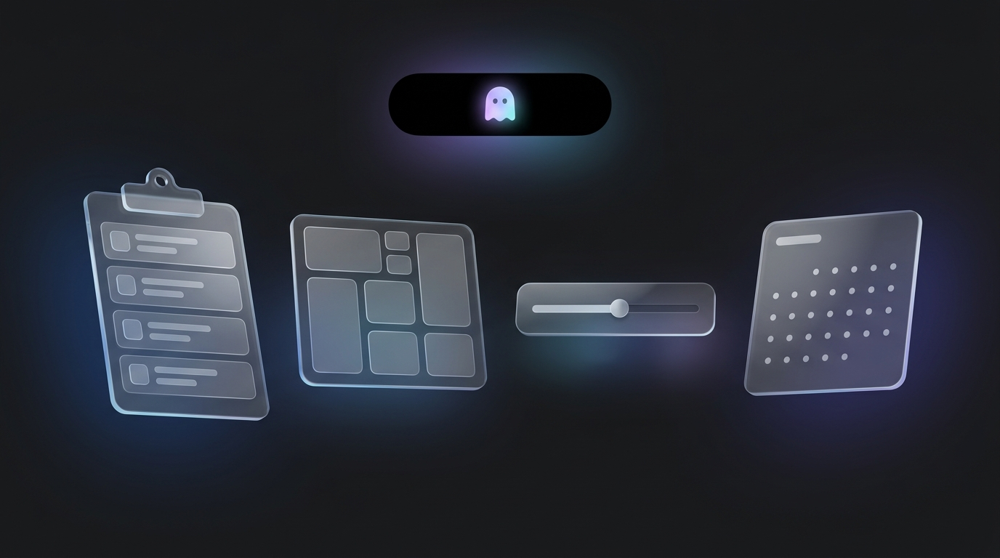

Figghost is written in Rust with a pure AppKit shell (the `objc2` crates). The settings window is a web page on a Liquid Glass window; every rule behind it lives in tested Rust. It runs in the menu bar, uses about 25 MB with the settings window closed, and is available in English and Vietnamese.

A first **beta for Windows and Linux** has the tray icon, the clipboard history, notes, the AI agents and the MCP server; the notch and the other macOS features are not in it yet. See [Windows and Linux (beta)](#windows-and-linux-beta).

## Contents

- [Feature list](#feature-list)
- [The settings window](#the-settings-window)
- [Highlights](#highlights)
- [Features in detail](#features-in-detail)
- [Install](#install)
- [Build and run](#build-and-run)
- [Windows and Linux (beta)](#windows-and-linux-beta)
- [Design](#design)
- [Configuration](#configuration)
- [Data and privacy](#data-and-privacy)
- [Technology choices](#technology-choices)
- [Development](#development)

## Feature list

The settings window keeps every feature under six icons in a dock at its foot, and this list follows the same six groups and the same page names: the English name, then the one the Vietnamese interface shows. Features marked "off by default" are switched on from their own page.

### Cài đặt chung (General)

| Page | Vietnamese | What it does |
| --- | --- | --- |
| General | Chung | Launch at login, the hello from the ghost, theme and language, a one-press check of every permission, and a tile to switch each main feature |
| Mole | Mole | Health score of the Mac and clean-up of caches, old build folders, installers and apps with their leftovers, in lists that fill in by themselves and are removed from together (off by default) |
| About | Giới thiệu | Version, a daily look for a new version with install in the app, what is new, privacy, the data folder and the licences |

### Chuột & Thao tác (Mouse & Cursor)

| Page | Vietnamese | What it does |
| --- | --- | --- |
| Scrolling | Cuộn chuột | Smooth wheel scrolling with a curve you can see, a reverse direction for external mice only, modifier keys for sideways, faster and zoom, and rules for each app |
| Cursor | Con trỏ | A rainbow arrow, a pixel character or any picture or GIF as the pointer (off by default) |
| Drag wheel | Vòng kéo thả | A wheel around the pointer while you drag a file: resize, compress, split or merge PDFs, annotate, copy its text, cut out the subject, strip metadata, turn a video into a GIF |

### Notch & Tiện ích (Notch & Island)

| Page | Vietnamese | What it does |
| --- | --- | --- |
| Notch | Notch | The shape that grows out of the top edge: size, material, opening rule, behaviour over full-screen apps, the tabs it shows, window snapping and the volume indicator in seven styles |
| Live islands | Đảo trạng thái | Small notices out of the closed notch: Caps Lock, charger, battery, drives, downloads, camera and microphone (off by default) |
| Music widget | Widget nhạc | A floating Liquid Glass player on the desktop in five styles, optionally above the lock screen (off by default) |

### Tab của notch (Notch tabs)

The notch always has Clipboard, Shelf, Media (with lyrics), Focus and Sound; these are the pages of the tabs that you add. The ones marked off by default join the strip only when turned on.

| Page | Vietnamese | What it does |
| --- | --- | --- |
| Calendar | Lịch | Today's events and reminders, and an alert before a meeting with a button that joins the Zoom, Meet, Teams or Webex link (off by default) |
| Day progress | Tiến độ ngày | How much of the day has gone, with today's events along a line (off by default) |
| AI agents | Tác tử AI | Claude Code, Codex and pi sessions, usage limits, tokens and cost, and Allow or Deny and choices answered on the notch; Orca accounts and switching |
| Notes | Ghi chú | A scratchpad of plain text files (off by default) |
| Launcher | Mở nhanh | A grid of up to twelve apps, folders and Shortcuts (off by default) |
| Weather | Thời tiết | Up to eight cities: now, the next hours and days (off by default) |
| Pull requests | Yêu cầu duyệt | Review requests waiting for you on GitHub and GitLab (off by default) |
| Pomodoro | Pomodoro | Work sessions and breaks with a ring, a streak and a shortcut (off by default) |
| Screen Time | Thời gian dùng | How long each app was in front, today and over seven days (off by default) |
| System | Hệ thống | Processor, memory, network, graphics, disk, heat, fans and battery health (off by default) |
| Devices | Thiết bị | The charge of connected Bluetooth devices, with a warning when one runs low (off by default) |
| Displays | Màn hình | Brightness and contrast of external displays over DDC/CI, and the brightness keys for them (off by default) |

### Bảng tạm & Công cụ (Clipboard & Tools)

| Page | Vietnamese | What it does |
| --- | --- | --- |
| Clipboard | Clipboard | History of text, links, code, images and files with instant search, pinning, Copy Stack, boards, sensitive data kept out, and an MCP server for AI assistants (off by default) |
| Smart Select | Chọn thông minh | What the selected text means: units, money, times in other zones, a translation (off by default) |
| Translate | Dịch | Select text anywhere and a glass window next to the pointer translates it (off by default) |
| Vietnamese typing | Gõ tiếng Việt | Telex or VNI in every app, VI or EN on the notch and in the menu bar, a shortcut to switch, apps left alone (off by default) |
| Capture | Chụp màn hình | Screenshots, scrolling capture, recordings as MP4 or GIF, an editor and text recognition in Vietnamese and English (off by default) |
| Colour picker | Chọn màu | A loupe on a frozen screen that copies HEX, RGB, HSL or HSB (off by default) |
| Utilities | Tiện ích | Keep the Mac awake, mute the microphone for every app, lock the keyboard while you clean it, snooze the notch (off by default) |

### Cửa sổ & Phím tắt (Window & Keys)

| Page | Vietnamese | What it does |
| --- | --- | --- |
| Window snapping | Chia cửa sổ | Layouts per screen from presets or a grid, opened by dragging a window to the top edge or by shortcut |
| Always on top | Luôn trên cùng | A shortcut keeps a window in front with a red border (off by default) |
| Shortcuts | Phím tắt | Every shortcut of the clipboard popup and the notch in one place, with conflicts refused |

### Also built in

Sound for each app (volume to 400 %, output device, equalizer, bass and treble, 3D sound for headphones), the clipboard mascot, a hider for menu bar icons, dragging a window onto the notch to snap it, a hello from the ghost each time you open the app, and updates that ask before they install.

## The settings window

Opening the app opens its settings; closing the window sends the app back to the menu bar. The page groups are the six icons of the glass dock at the foot of the window: press one, or press and drag along the dock, and a lens of clear glass follows your finger and opens the group under it. The search in the title bar (Command-K) finds a page by what its settings say.

| | |
| --- | --- |
| 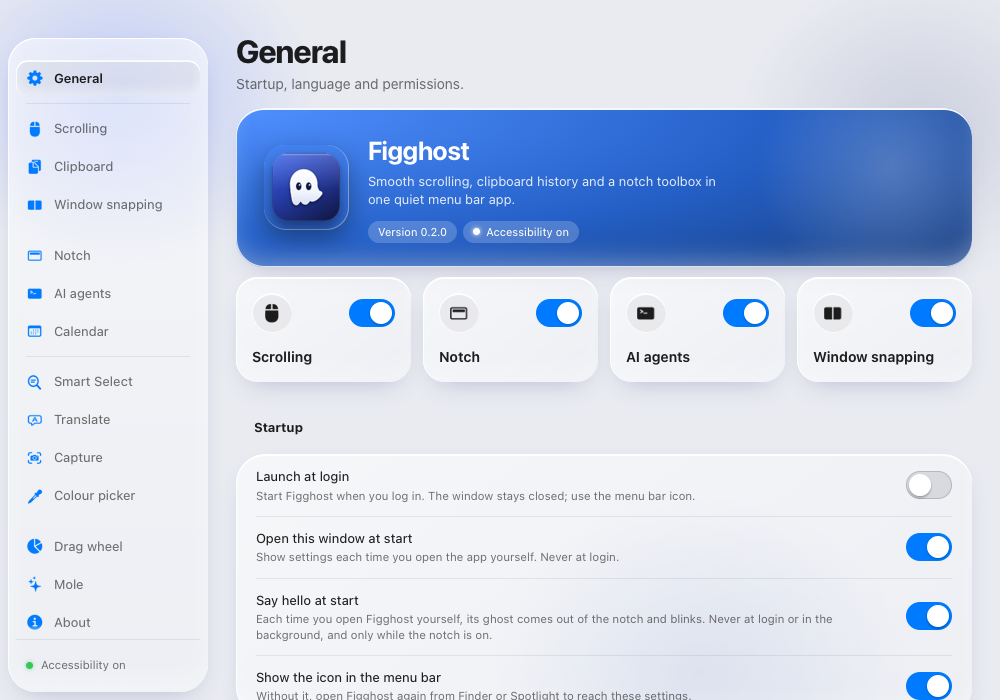 | 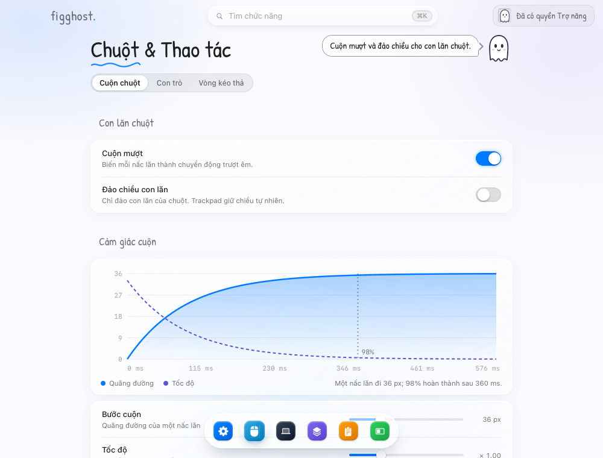 |
| 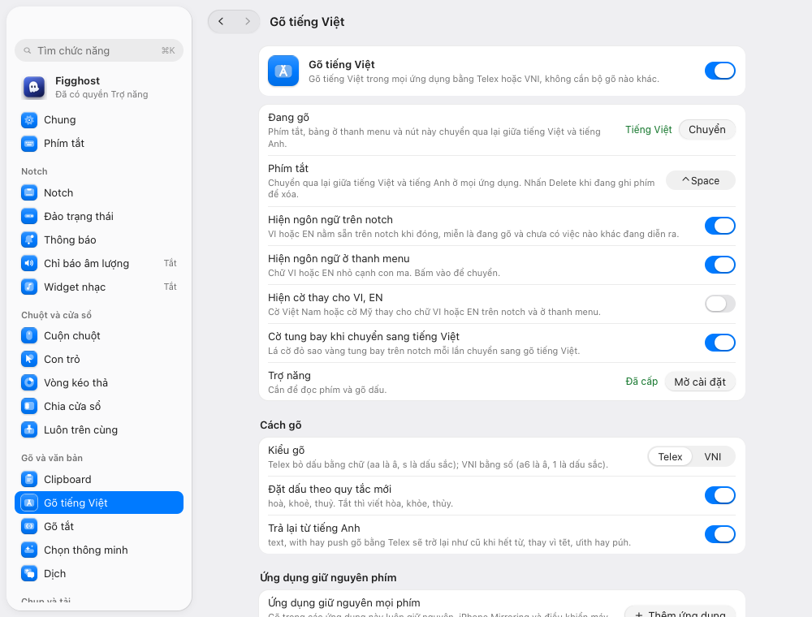 | 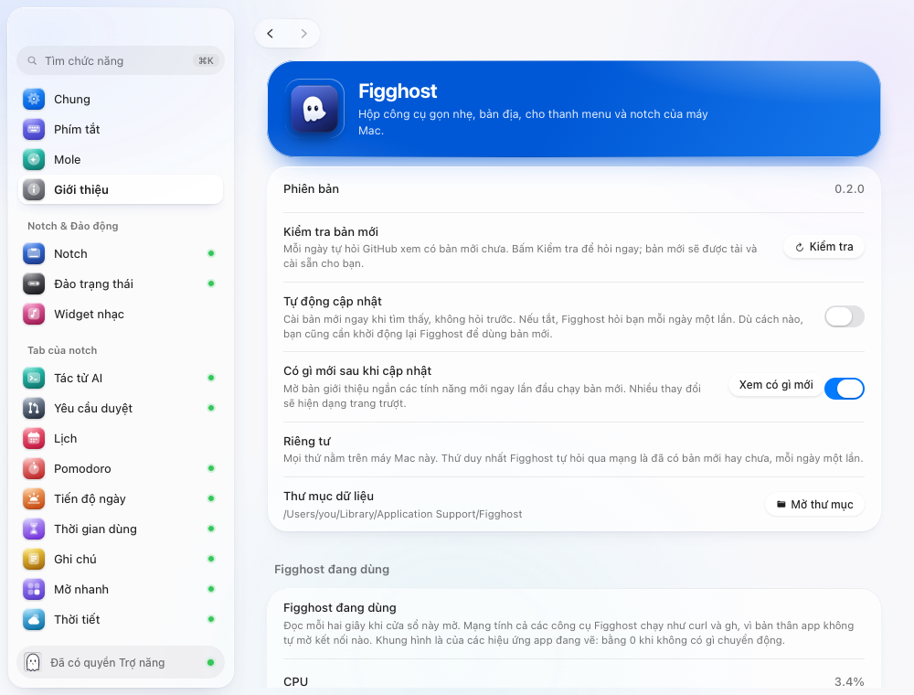 |

## Highlights

### The notch, with a tab for each tool

A black shape grows out of the top edge of the screen when the pointer reaches it: clipboard, shelf, media, AI agents, calendar, notes, launcher, weather, pull requests, pomodoro, screen time, sound and system, each a tab. Closed, it shows what is playing and what your coding agents are doing.

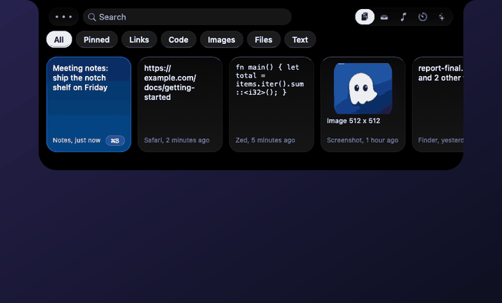

### A hello from the ghost

Each time you open Figghost yourself, its ghost comes down out of the notch, blinks once and goes back up. Never at login or when it starts in the background, and it can be turned off on the General page. The ghost was drawn with agy; there is also a [video](docs/images/ghost-hello.mp4).

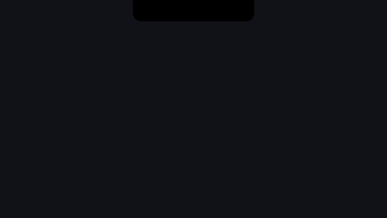

### Window snapping from the notch

Drag a window by its title bar to the top edge and the layouts hang under the notch: halves, thirds, quarters, a wide window beside a narrow one, or a layout you draw from a grid. Point at one and its cells show over the screen; go down into a cell and release to put the window there.

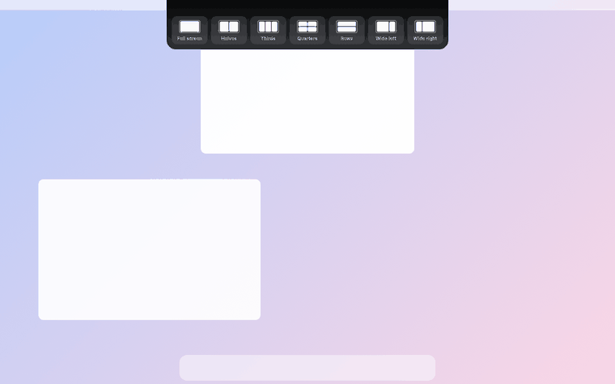

### Smart Select

Select text anywhere and press the shortcut. A small window next to the pointer says what it is: a length in other units, an amount of money in your currencies, a time in other zones, or a translation.

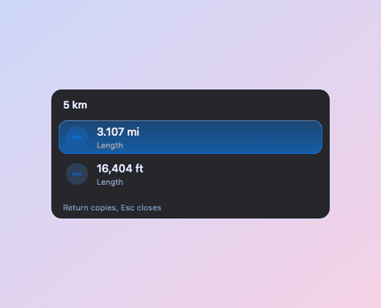

### Drag wheel

Start dragging a file and tap a modifier key: a wheel opens around the pointer with the things that can be done to it (resize, compress, split or merge PDFs, annotate, copy its text, cut out the subject, strip metadata, turn a video into a GIF). Drop on a slot to run it.

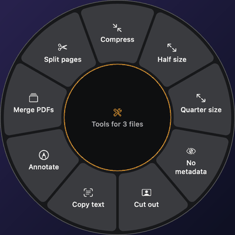

### A settings window that follows macOS

Liquid Glass, both themes, six groups in a dock, and every feature can be turned off on its own page. See [The settings window](#the-settings-window).

## Features in detail

Every picture here is drawn by the app's own code with no screen (`app-ui/settings_preview`, `macos-sys/render_notch`, `render_snap`, `render_smart`, `render_wheel`, `render_hud`, see [docs/development.md](docs/development.md)); the hero image was generated with agy. The GIFs are frames of those renders, and the pictures of the settings pages are the Vietnamese interface.

Opening the app opens its settings window; closing the window sends the app back to the menu bar. The features marked "off by default" are switched on in their own page of the settings.

### Scrolling (like Mos)

Smooth mouse-wheel scrolling, a reverse direction for external mice only, modifier keys (sideways, faster, zoom) and per-app rules. The curve drawn in the settings matches what the smoother really does.

### Clipboard history (like Maccy)

Text, links, code, images and files; instant search; pinning with a paste letter; Copy Stack; pinned boards; sensitive data kept out or masked; a popup at the pointer; and an MCP server so an AI assistant can read the history (off by default).

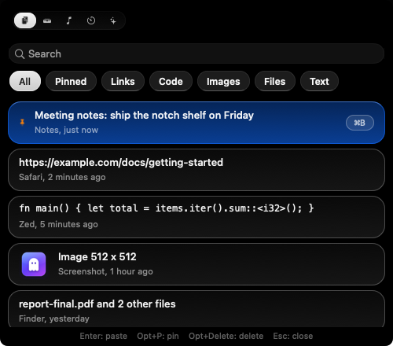

The Shelf tab keeps dropped files as references to where they live. Right-click one to ZIP it, convert it, make it smaller, remove its background or copy the text in the picture.

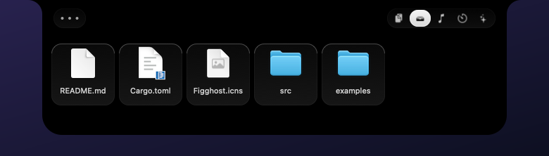

### Notch panel (like OneNotch)

Seven tabs, ten more that join them when their feature is turned on (System, Notes, Launcher, Weather, Pull requests, Pomodoro, Screen Time, Day progress, Devices and Displays), window snapping, an optional volume indicator, lyrics, live activities in the closed shape, and a size you choose (compact, standard, wide or custom). It shows over full-screen apps too, unless Show over full-screen apps on the Notch page is off: then it goes away completely while the app in front is full screen on its screen, and comes back, with its tabs and activities as they were, when that app leaves full screen or another one comes to the front.

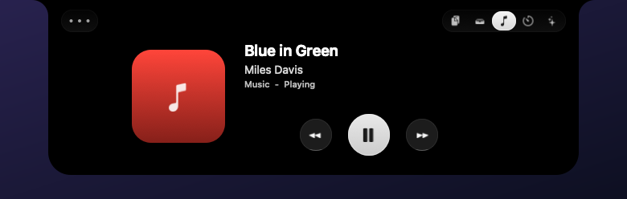

The System tab shows the processor core by core (the frugal cores and the fast ones apart), the memory as apps, wired and compressed with its pressure and the swap, the network with a minute of history, the graphics processor, the room on the startup disk, the heat of the processor in degrees with the state the system gives, the speed of the fans on a Mac that has them, and the health of the battery on a Mac that has one. It is off until it is turned on in Settings, under Notch tabs, System, where each card can be left out. It reads the system only while the tab is showing, once a second or as often as chosen, so an idle app does no work for it.

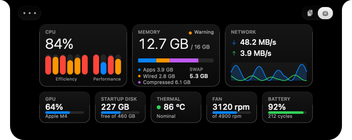

The Notes tab is a scratchpad: a list of notes at the left and an editor at the right. Every note is a plain text file in a folder of its own (`notes` in the data directory), so any other app can read it (a file longer than fifty thousand characters is not listed, so that it can never be cut); what is typed is saved a moment after the last key, a deleted note goes to the Trash, and a note left empty leaves no file. It is off until it is turned on in Settings, under Notch tabs, Notes.

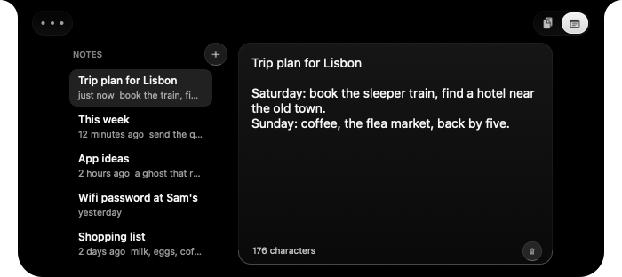

The Launcher tab is a grid of up to twelve tiles for the apps, folders and Apple Shortcuts you pin in Settings, under Notch tabs, Launcher. A tile does something only when it is pressed: an app is found by its bundle identifier where it is now, a folder opens in the Finder, and a Shortcut is run by its name with the system's `shortcuts` command (given the name as an argument, never through a shell); the notch goes away after it. It is off until it is turned on, and has nothing pinned until you pin something.

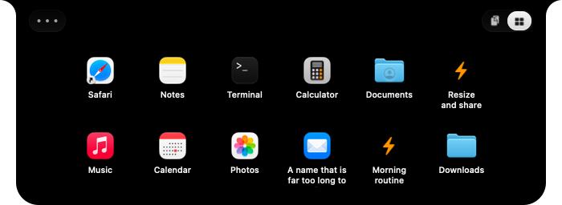

The Screen Time tab shows how long each app was in front today and over the last seven days, as a total and a list with a bar for each, by app or by the group an app says it belongs to (Productivity, Developer tools, Utilities, and so on). Every five seconds, while someone is at the Mac, the app in front is given that time; time stops counting when the keyboard and pointer have been still for the time you choose (1, 2 or 5 minutes). Only the name and bundle identifier of the app and the seconds are kept, for thirty days, in the file `screentime.json` of the data directory: no window title, no text, no screen, no key, no permission, and nothing leaves the Mac. It is off until it is turned on in Settings, under Notch tabs, Screen Time.

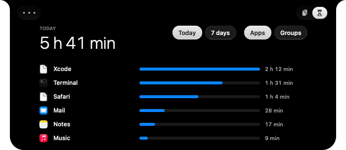

The Pomodoro tab alternates work sessions and breaks: a ring fills as a stage passes with the clock in it, the dots of the round show how many sessions are done, and a long break ends each round (the lengths and the number of sessions in a round are yours to choose). While a stage runs, the time left sits in the closed notch, and when it ends there is a sound and the notch opens on the tab for a few seconds (each can be switched off; the next stage can start by itself). The tab counts the sessions done today, the days in a row and the last seven days, in the file `pomodoro.json` of the data directory for thirty days, and a shortcut starts and pauses it from any app. It is a tab beside Focus, which stays the plain countdown it was, and is off until it is turned on in Settings, under Notch tabs, Pomodoro.

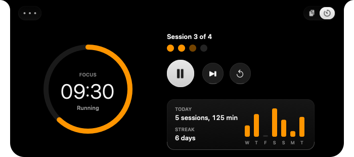

The Pull requests tab lists the review requests that wait for you on GitHub and GitLab, newest first, with who wrote each and how long ago, and a dot on the tab's icon while there are some; pressing a row opens it in the browser. Figghost never sees your password or token: it asks the `gh` and `glab` command-line tools you already signed in with (found in Homebrew's and the usual places, run with fixed arguments and no shell), reads only requests that have a title, a project, a number, a time and an https address, opens only that address, and writes nothing to disk. It looks soon after the app starts and then at the interval you choose (5, 10, 30 or 60 minutes) while it is on, and the settings page says whether each tool is installed and signed in. It is off until it is turned on in Settings, under Notch tabs, Pull requests.

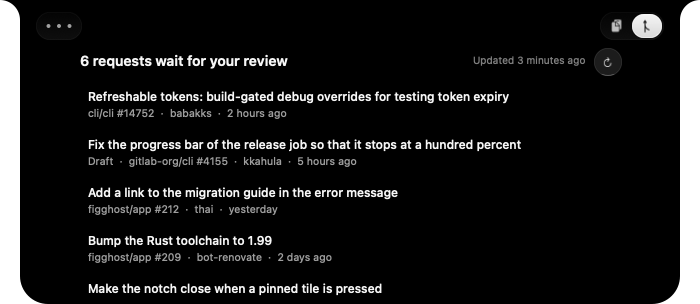

The Weather tab shows the weather of up to eight cities, one at a time: now, the next six hours and the next five days, in Celsius or Fahrenheit. With more than one city, the arrows beside the name (or the Left and Right keys) flip to the next, and "2/3" says where you are; the tab opens on the first city of the list, and remembers the one shown while the app runs. It is the only tab that goes online, so it is off until it is turned on and a city is added in Settings, under Notch tabs, Weather, where cities are searched for, added, moved up and removed; until then its Open Settings button goes there. The forecast comes from Open-Meteo, which needs no account or key, through the system's `curl`; what is sent is the name typed when searching for a city and then the coordinates of the city on screen, never the location of the Mac, and it asks only while the tab is open, only for the city it shows, and no more than once in ten minutes for each city.

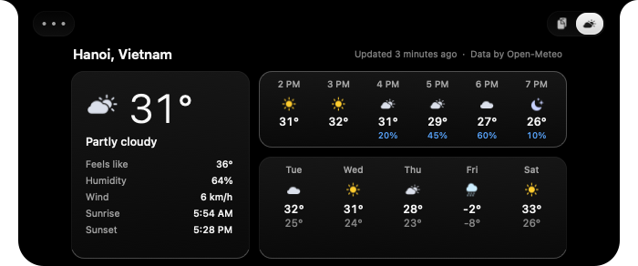

The Day progress tab shows how much of the day has gone, as a large percentage and a line from the morning to bedtime (7 AM and 11 PM, both yours to choose). Today's events lie along the line as bars in the colour of their calendar (all-day events are left out), the one that is on now brighter, each reminder due at a time of day is a dot on it, and under it are what is on now and what comes next with how far off it is. It reads the calendars the Calendar tab reads, leaving out those that tab leaves out, and asks for nothing more: when the calendar is not allowed yet it says so instead of showing an empty day. It is off until it is turned on in Settings, under Notch tabs, Day progress; it looks at the day when the tab opens and again every half minute while the tab shows, and keeps nothing on disk.

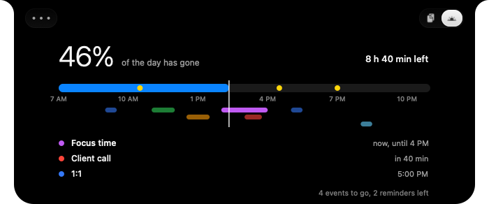

The Devices tab shows the charge of the Bluetooth devices that are connected, a card for each with its symbol, its name and a gauge: a mouse, keyboard, trackpad, controller, speaker or headphones, and a pair of earbuds with each bud and its case. A device at or under the level you choose (10, 15, 20 or 30 percent) gets a warning colour and the word Low. A device shows a charge only when it reports one to the Mac, which many keyboards, mice and speakers do not; those are listed without one. Some report it only now and then (a headset may do so once, when it connects), so a charge that a device has stopped reporting is kept for two hours, drawn dimmer and marked with when it was reported. The Mac is asked, through its own `system_profiler` (run with fixed arguments and no shell, off the main thread and stopped after a few seconds), when the tab opens and every half minute while it shows, and never otherwise. It needs no permission and nothing is stored. It is off until it is turned on in Settings, under Notch tabs, Devices.

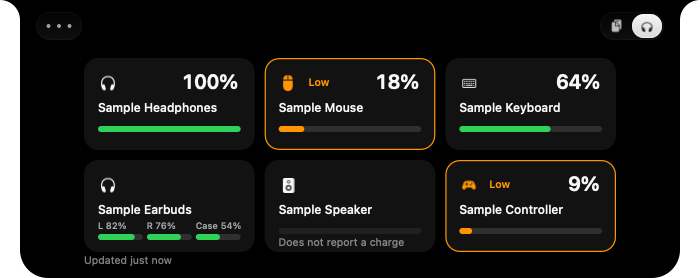

The Displays tab sets the brightness and contrast of each external display, as the display's own buttons would (like MonitorControl): a card for each display that answers over DDC/CI, with a slider for each setting it has. The display itself changes; nothing is laid over the picture. With the brightness keys turned on as well, they move every external display together and show the level in the volume indicator's look, with a sun in place of the speaker; while a built-in screen is lit the keys stay with it, and Control with a key sets the external displays. The displays are looked for when the tab opens and when a key needs them, and only the brightness and contrast are ever asked or set. The tab needs no permission and the keys need Accessibility. A display behind a hub, a DisplayLink adapter or some HDMI ports does not answer and is not listed. It is off until it is turned on in Settings, under Notch tabs, Displays.

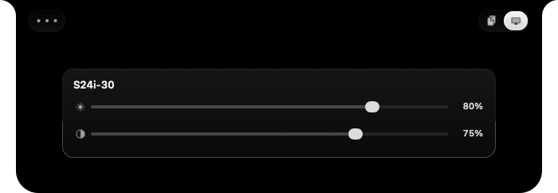

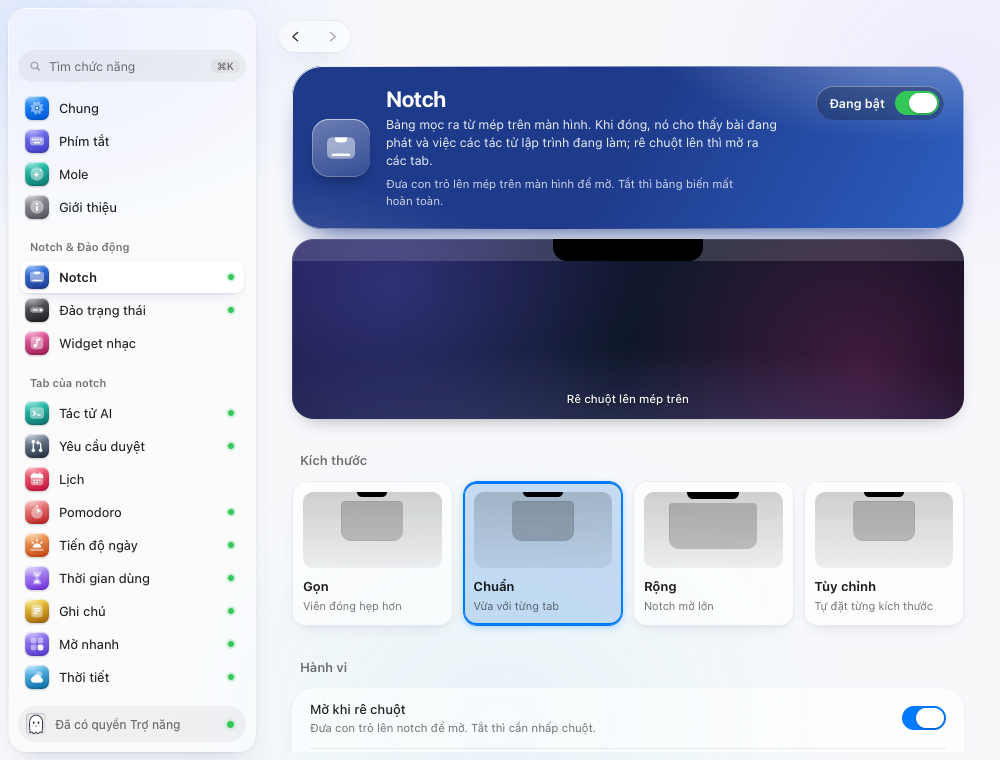

The volume indicator has seven styles, each drawn at three levels:

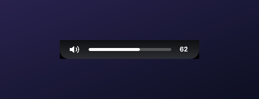

### AI agents

The Agents tab shows Claude Code, Codex and pi sessions (working, waiting, done), the usage limits of Claude Code and Codex with a refresh button, and the tokens and cost at API prices. A permission request from Claude Code or Codex is answered from the notch with Allow or Deny, and a question with choices (Claude Code's AskUserQuestion, pi's ask_user_question) with a button per choice; the closed notch shows that a question is waiting. The card stays put while other sessions report, and while the pointer is on it the agent keeps waiting for the answer; with several requests open, a press on the row of a waiting session brings its request onto the card. When an agent finishes or fails, the closed notch says which one and where for a few seconds, for example "Claude figghost" in green or "Pi shop" in red; a finished agent plays no sound, and a session that was already done does not say so again. In the closed notch each agent is a small pixel character, Claude Code as Clawd from its welcome screen, Codex as its cloud and pi as its letter: it types at a laptop or hoes a field while it works, holds up a question mark while it asks, jumps for joy when it finishes and cries when it fails.

pi is connected from the same settings page: Figghost writes an extension to `~/.pi/agent/extensions/figghost.ts` that reports pi's sessions and puts its questions on the notch while pi asks them in its terminal too, so the first answer wins either way. When pi runs Claude Code through its claude-bridge provider, the Claude Code hooks inside it stay quiet, since pi reports that session itself.

Accounts: the AI agents page of the settings lists the Claude Code and Codex accounts you keep in Orca, with their plan, which one Orca uses and which one the plain `claude` (or `codex`) command uses, and the five-hour and weekly limits of each Claude account. Switch makes the plain command use one of them, after a confirmation: Figghost keeps a private copy (mode 0600, the last five) of the sign-in and `oauthAccount` the command had, then copies the account's sign-in into the Keychain item `Claude Code-credentials` and its `oauthAccount` into `~/.claude.json`, keeping every other key in its place (for Codex, its `auth.json` over `~/.codex/auth.json`). Restore puts the newest copy back. New sessions use the new account; running ones may need a restart. The switched account then shares one sign-in with Orca, so when one of them renews it the other may have to sign in again. The Agents tab of the notch labels its Claude usage rows with the account the `claude` command uses.

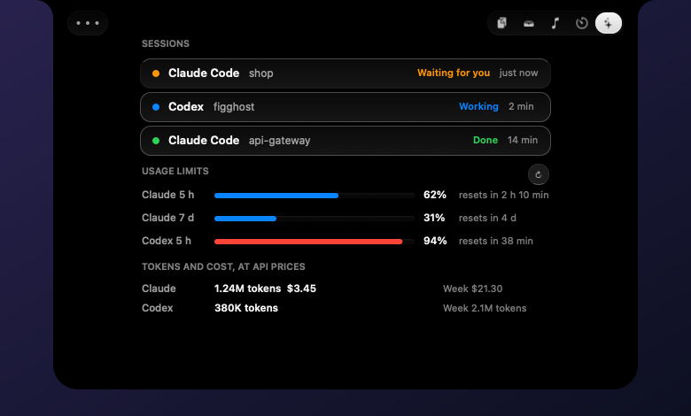

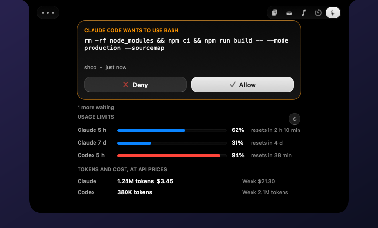

### Window snapping

Layouts per screen, made from presets or from a grid, opened by dragging a window to the top edge.

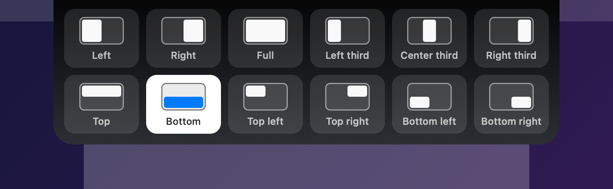

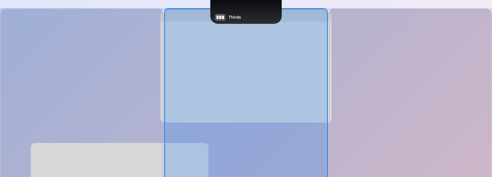

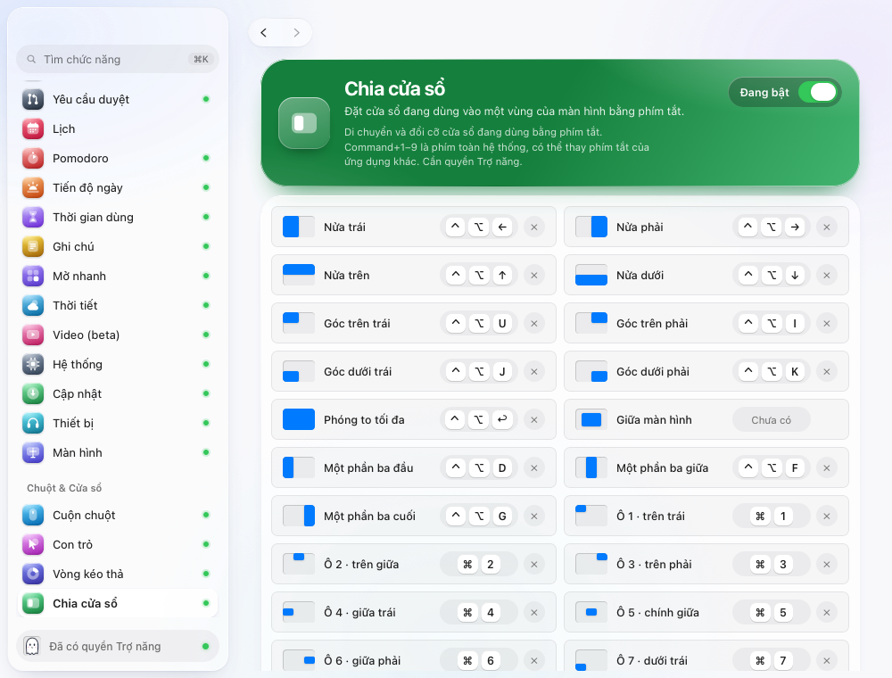

### Always on top

A shortcut keeps the window in front above all the others, with a red border round it (off by default). macOS lets a program raise only its own windows, so while another window covers the pinned one, a live picture of it is shown over the cover, and a click on the picture brings the real window forward. One window is pinned at a time, from the shortcut or from the switch in the menu bar panel, and the same shortcut lets go of it. Floating windows such as picture in picture stay above it, as the system means them to.

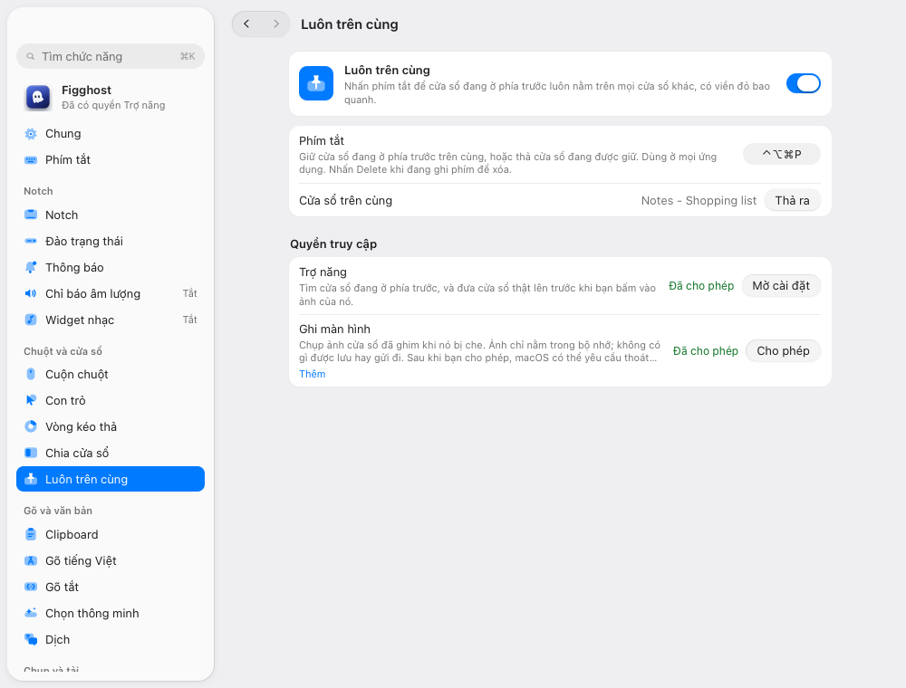

### Cursor

Gives the pointer a look of its own (off by default): a rainbow arrow whose colour turns, one of the six pixel characters of the clipboard mascot that stands, blinks and beams when you point at a link, or any picture, GIF or animated PNG you choose, with its own size, speed and point that clicks. The arrow and the hand over links change; the text cursor stays the system's. The system plays the animation, so nothing runs while the pointer moves. It shows over every other app, and the pointer goes back to normal when you turn it off or quit; if the app is killed, turning the feature off and on again gives the cursors back.

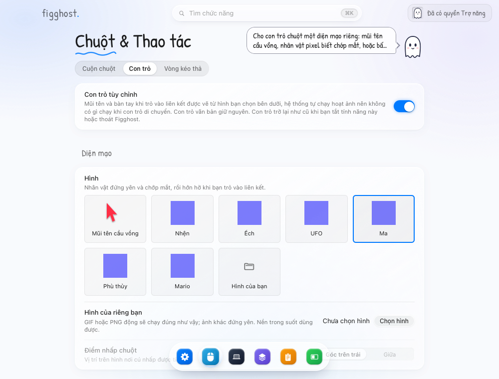

### Sound (like SoundSource and Boom 3D)

Volume to 400 %, mute, output device and equalizer for each app, effects on everything played (equalizer, compressor, limiter), and volume keys for speakers the system cannot turn down.

### Calendar

Today's events and reminders in the notch, and an alert before a meeting with a button that joins the Zoom, Meet, Teams or Webex link (off by default).

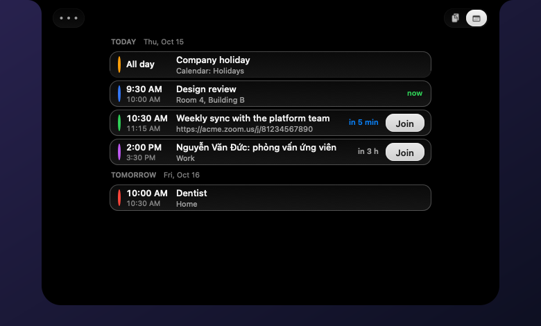

### Smart Select and translation

Units, money, times and translation for the selected text (off by default). Rates are one table downloaded once; translation sends at most 450 characters to a public service, and only when you ask for it.

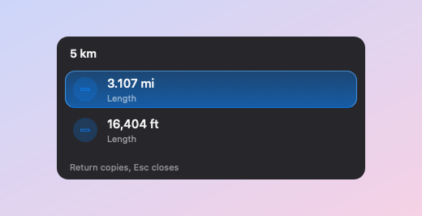

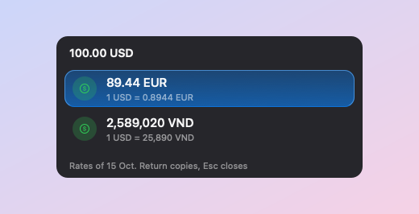

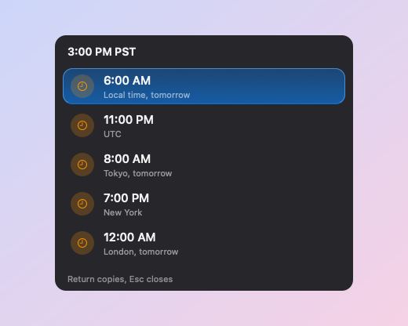

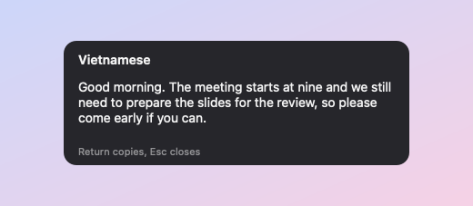

### Vietnamese typing (like Gõ Nhanh)

Telex or VNI in every app with no other input method, through the engine of [Gõ Nhanh](https://github.com/khaphanspace/gonhanh.org) (off by default). The marks go where the new rules put them (`hoà`, `khoẻ`) or the older way, English words come back when the word ends (`text`, `with`), a shortcut (Control+Space by default, recorded by the app itself so that the system's own use of the same keys cannot take it) or the menu bar panel switches to English and back with a word on the notch, VI or EN stays on the closed notch and in a small menu bar item of its own (click it to switch; each can be turned off), and the apps you list are left alone. Address bars, search fields, Spotlight (written through Accessibility, with the keys as the fallback), editors built on web views, terminals and Adobe apps each get the way of typing that Gõ Nhanh settled on for them. While another Vietnamese input method runs, Figghost leaves every key alone.

### Capture (like CleanShot X)

Screenshots, scrolling capture, screen recordings (MP4 or GIF, with a key display, the computer's audio and the microphone), an editor, text recognition in Vietnamese and English, and quick action shortcuts after a capture (off by default).

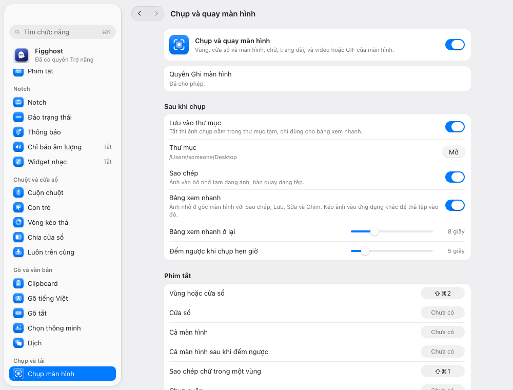

### Colour picker

A loupe on a frozen screen; the colour is copied as HEX, RGB, HSL or HSB (off by default).

### Mole

Checks the health of the Mac and frees disk space, after the features of [Mole](https://github.com/tw93/Mole) but done by Figghost itself, so nothing needs installing: caches and logs, old build folders of projects, installer files, apps with what they left behind, and what takes the disk. The lists fill in as the page opens; choose rows, or all of them, and remove them together. Caches and build folders are deleted, everything else goes to the Trash (off by default).

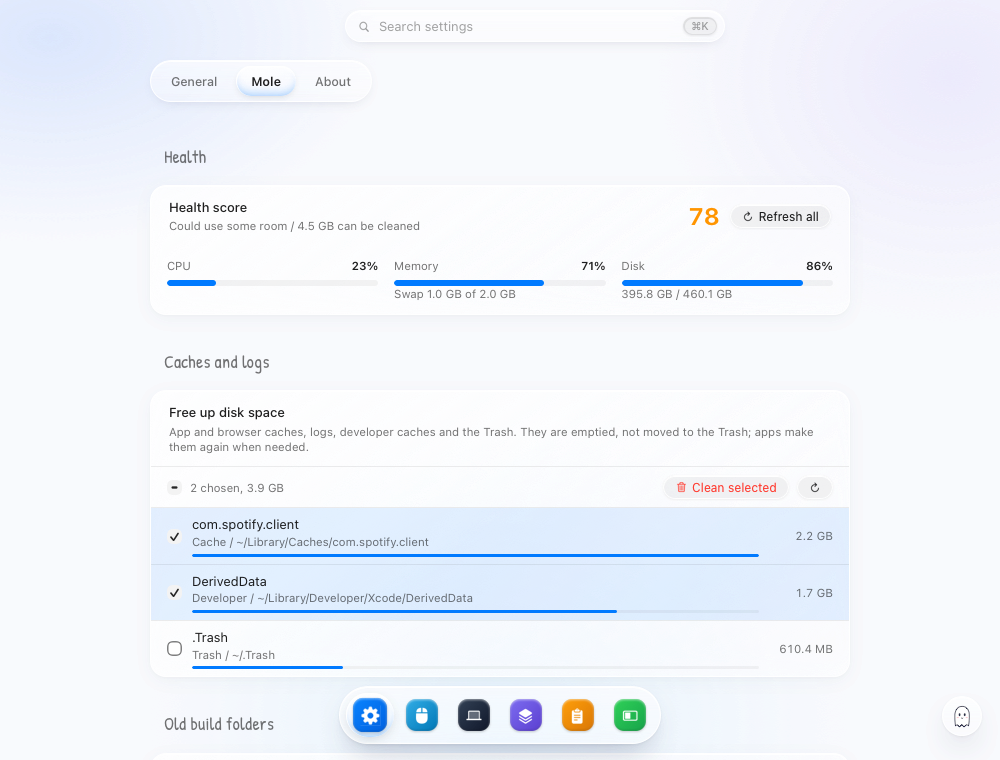

### Live islands

Small notices that come out of the closed notch for a moment: Caps Lock turning on or off, the charger plugged in or out, a battery that is full (at a level you choose) or low, a drive that arrives or leaves (and an Eject entry for each drive in the menu bar panel), a finished download in the Downloads folder, and an app starting to use the camera or the microphone (each with a switch of its own). Each one can be switched off on its own and shown as a sample; nothing reads what is on the screen or what is typed (off by default).

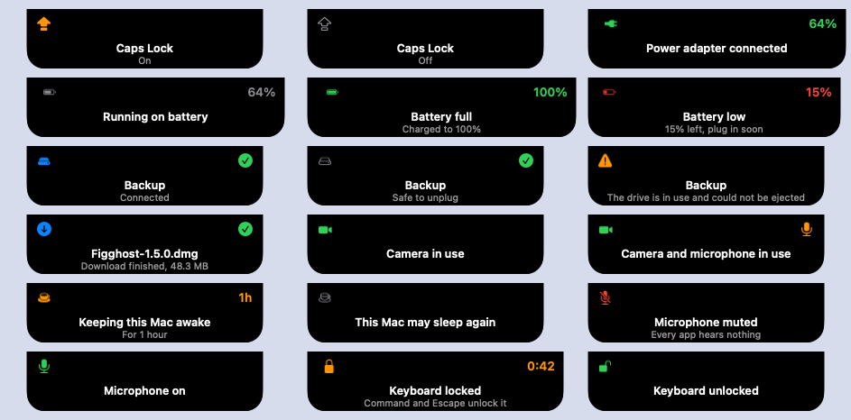

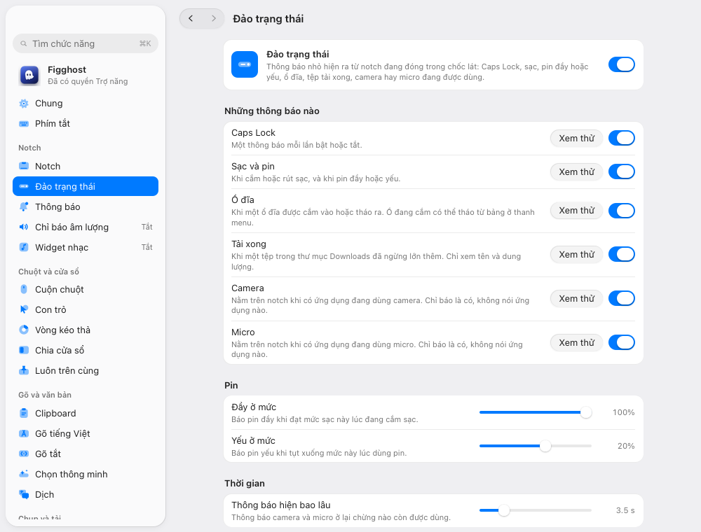

### Utilities

Keep the Mac awake for 15 minutes to 4 hours or until you stop it, mute the microphone itself so every app hears nothing (it is unmuted when Figghost quits, since nothing else on the Mac has a switch for it), lock the keyboard while you wipe it (Command and Escape unlock it at once, and it unlocks by itself after the time you set), and snooze the notch for 5 minutes to 2 hours or until you wake it, so that it does not open when the pointer reaches the top of the screen while you present or play (a click on it, and a coding agent that waits for an answer, still open it). Each has a place in the menu bar panel (one switch for keeping awake and one for snoozing, which start the length chosen on this page; the lists of lengths are in the menu), a shortcut that works in any app and a notice on the notch (off by default).

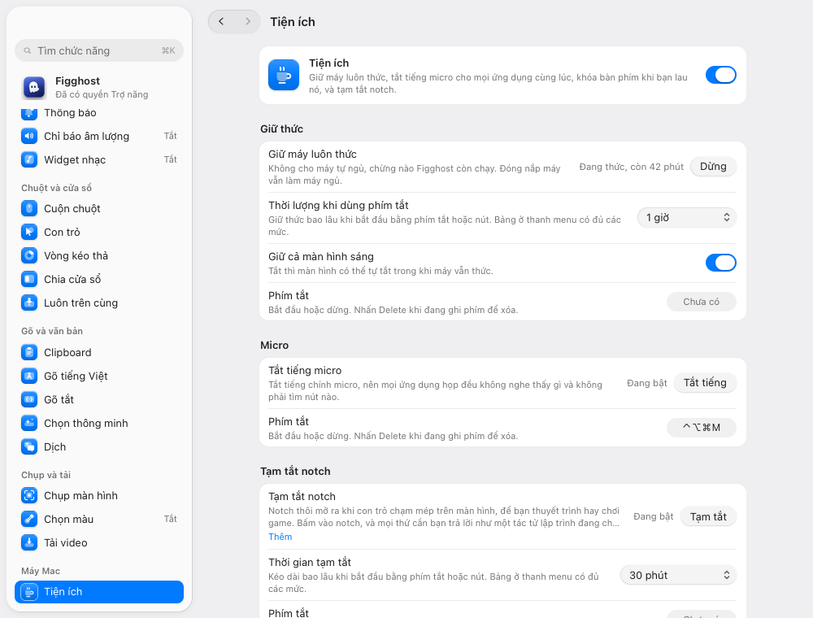

### And the rest

- Clipboard mascot: a small character that plays a story each time something is copied (off by default).
- Menu bar icons: hide the ones you do not need behind a divider (off by default).
- Dragging a window onto the notch to snap it (off by default).
- Updates: Figghost looks for a new version once a day and asks before it installs; a popup says what is new after an update.

## Install

An Apple silicon Mac with macOS 13 or later. With Homebrew:

    brew tap eliasbui/figghost
    brew install --cask eliasbui/figghost/figghost

Without Homebrew:

    curl -fsSL https://raw.githubusercontent.com/eliasbui/figghost/main/scripts/install.sh | sh

Writing the cask out in full installs it from the tap and trusts only that cask, so no `brew trust` is needed. Both ways put `Figghost.app` in `/Applications` (the script takes `DEST=~/Applications` for somewhere else). The app is signed ad hoc and not notarized, so both remove the quarantine flag after installing it, as other open source notch apps do; build it yourself (below) if you would rather not. `brew uninstall --cask figghost` removes the app, and `--zap` its data in `~/Library/Application Support/Figghost` too. Figghost looks for a new version once a day and asks before it installs one, with what is new in it; with *Update automatically* on in the About page it installs without asking, and *Check now* there does it at once. An update replaces the app where it is, deletes the old copy and the download, and takes effect when Figghost is restarted (the popup has a button for that). It needs to be able to write in the folder the app is in, which an administrator can for `/Applications`; where it cannot, the About page links to the release instead, and running the install command again works as before. Accessibility stays granted through updates, because the app is signed with a name that every build shares; the update from a version that was signed per build asks for it one last time (remove the old Figghost from the list in System Settings, Privacy & Security, Accessibility, then grant it again).

## Build and run

Rust is installed with rustup into `~/.cargo`. Keep the build directory outside the project:

    . "$HOME/.cargo/env"
    export CARGO_TARGET_DIR="$HOME/Library/Caches/figghost-target"
    cargo test --workspace
    cargo clippy --workspace --all-targets -- -D warnings
    scripts/bundle.sh            # creates dist/Figghost.app
    scripts/release.sh 0.2.1     # publishes a release and points the Homebrew cask at it (DRY_RUN=1 to check first)

For development, create a persistent local Code Signing certificate in Keychain Access (for example, `Figghost Local`) and install the watcher once with `cargo install cargo-watch`. Then `SIGN_IDENTITY="Figghost Local" scripts/dev.sh` rebuilds and restarts the local app whenever source files change. The stable identity keeps the Accessibility permission across rebuilds; stop the watcher with Control-C.

Accessibility access is tied to the code signature of the app. The default ad-hoc signature names the app (`vn.figghost.app`) instead of one build, so a rebuild or an update keeps the access that was granted. That is only as strong as the name: a program that signs itself with the same name is let in too. To pin the access to a certificate that nobody else holds, create a local code-signing certificate in Keychain and run `SIGN_IDENTITY="Certificate name" scripts/bundle.sh`; changing from one kind of signature to the other asks for the access once more. `scripts/dev.sh` takes `SIGN_IDENTITY=-` for the ad-hoc one.

Accessibility is needed for smooth scrolling, automatic paste, window snapping, keeping a window on top and the volume indicator. Without it the app still runs: the popup and the notch work, items are copied for a manual paste, and the scroll engine starts by itself once access is granted. Music and Spotify ask once for permission to be read by the media tab.

The app icon is drawn by code: `cargo run -p macos-sys --example make_icon -- X.iconset`, then `iconutil -c icns X.iconset -o crates/app-ui/assets/Figghost.icns`.

## Windows and Linux (beta)

Figghost for Windows 10 and 11 and for Linux is a **beta**. It is a program of its own, `figghost` (`crates/desktop`), built on the same tested Rust as the macOS app (`core-clipboard`, `core-agents`, `core-notes`): an icon in the tray and one window, which is a web page in the system's web view (WebView2 on Windows, WebKitGTK on Linux). From 2.0.4 each [GitHub release](https://github.com/eliasbui/figghost/releases/latest) has the beta for Windows (`figghost-<version>-windows-x86_64.zip`) and for Linux (`figghost-<version>-linux-<arch>.tar.gz`); unzip it and run `figghost`. They are not signed and there is no installer yet: Windows SmartScreen asks once, and on Linux the WebKitGTK, GTK and AppIndicator libraries of the build list below (without `-dev`) must be installed. Or build it from source as below.

In the beta:

- The tray icon and its menu; the window goes away entirely when it is closed, so the app costs little in the tray.
- Clipboard history: text, links, code and files, and pictures on Windows. The search takes the same filters as on macOS (`@link`, `@code`, `@text`, `@image`, `@file`, `@pin`), items can be pinned and deleted, and a global shortcut (`ctrl+alt+KeyV` by default) opens the history. A copy that looks like a password or a key is hidden and deleted after an hour, or never kept, or kept, as chosen; on Windows what a password manager marks as private is never read.
- Notes, each a plain text file in the `notes` folder of the data directory; a deleted note goes to the trash.
- AI agents: installing and removing the hooks of Claude Code and Codex (and pi, on Linux), the sessions and what each is doing, and the commands that wait for permission, allowed or denied from the window.
- The MCP server, `figghost --mcp`, off until it is turned on in the settings.
- Start at login, English and Vietnamese, light and dark.

Not in the beta yet: the notch and its tabs, smooth scrolling, window snapping, per-app sound, capture, Smart Select, the drag wheel, Vietnamese typing and the other macOS features. What each would take on Windows and on Linux is in [docs/research-linux-windows.md](docs/research-linux-windows.md).

Known limits of the beta:

- The clipboard is read twice a second, not at each change.
- On Linux the history keeps text and files, not pictures, and a copy that a password manager marks as secret is not told apart from another one (the setting for passwords is the guard).
- Under Wayland the global shortcut only fires while an X11 app has the focus: bind a key in the desktop's settings to the command `figghost` instead, since a second start shows the window of the running one. GNOME shows the tray icon only with the AppIndicator extension.
- On Windows, Claude Code runs its hooks in Git Bash, which it needs anyway; pi is not supported there yet.

Build on Linux (Debian and Ubuntu package names):

    sudo apt install libwebkit2gtk-4.1-dev libgtk-3-dev libayatana-appindicator3-dev libxdo-dev libsqlite3-dev
    cargo build --release -p figghost-desktop        # target/release/figghost

Build on Windows, with Rust for MSVC (WebView2 comes with Windows 11; on Windows 10 it may have to be installed):

    cargo build --release -p figghost-desktop        # target\release\figghost.exe

`figghost --background` starts in the tray without the window. The data is in `%APPDATA%\Figghost` on Windows and in `$XDG_DATA_HOME/figghost` (`~/.local/share/figghost`) on Linux, with the same files as on macOS (`config.json`, `history.sqlite`, `images`, `notes`); `FIGGHOST_HOME` points it elsewhere. `scripts/check-desktop-linux.sh` builds and tests the beta in Docker, starts it on a virtual screen and takes a picture of the window; with `--windows` it also builds `figghost.exe` with MinGW.

## Design

The settings window has a world of its own on top of the system's: the ghost's night. Its look follows what the 2026 Apple Design Award apps share, a single made-up place that every part of the window belongs to, with the platform's own controls inside it. The sky behind the page follows the hour (dawn, day, dusk, and a night with stars in the dark theme); titles, the names of sections and what the ghost says are handwritten in Patrick Hand, which is used for nothing else; the ghost is the guide of every page (a bubble with what the page is for, a hop and another line when it is clicked), the sign of whether the app has the access it needs (awake, or asleep with closed eyes, and the words say the same) and the character of every empty list, and the big one in the General hero follows the pointer with its eyes. Nothing in it is the only sign of anything, so it holds for people who cannot tell the colours apart, and every animation stops under Reduce motion. [docs/design.md](docs/design.md) says how it is made and how to add to it.

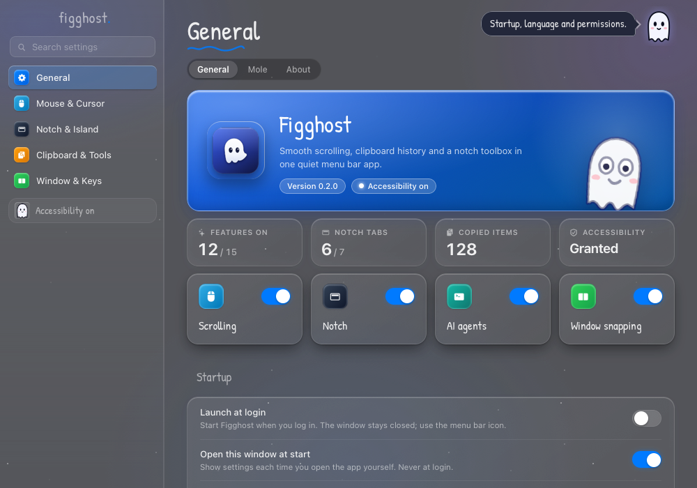

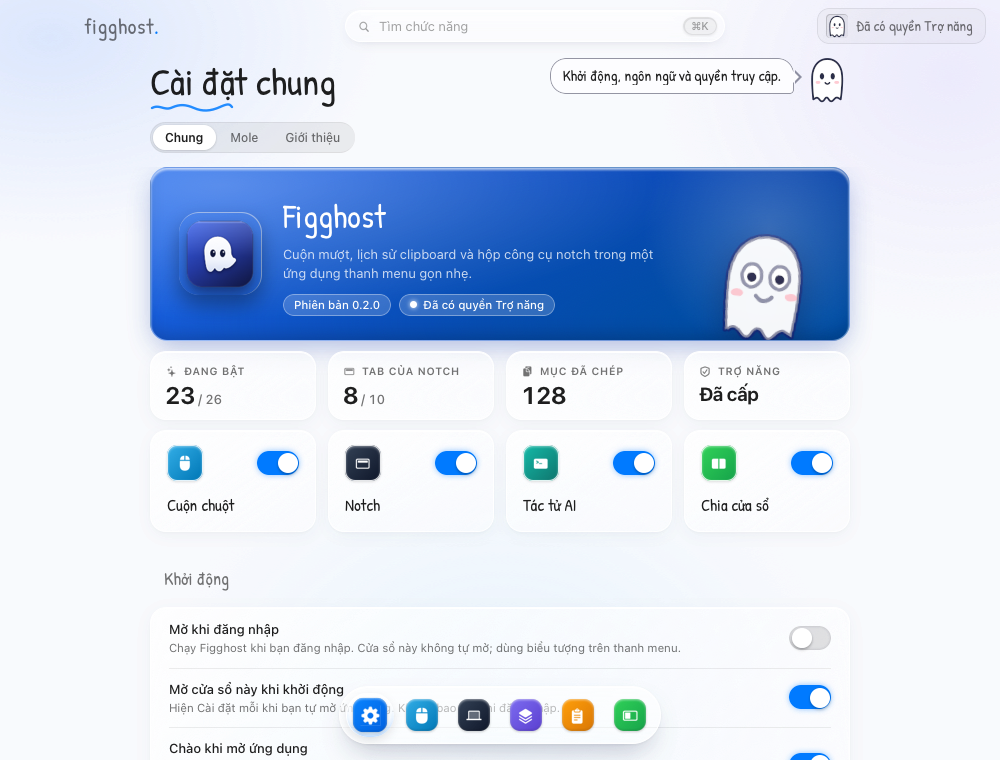

The window itself is a macOS window on Liquid Glass. A floating glass dock at its foot holds one icon for each of the six page groups, white SF Symbols on coloured tiles, with a lens that follows a press and a drag; the search sits in the middle of the title bar; the content is glass cards of grouped sections, a label and its control on each row, over a soft backdrop, and the General and About pages open on a hero card in the app's blue. Controls follow the system: they take the accent colour the user chose in System Settings, a state takes its own system colour (green when something is on or granted), buttons are 24 points tall and pop-up buttons and fields 24 or 28, section headers are 13 pt bold, and every icon, in this window and in the menu bar panel, is an SF Symbol drawn by the system. In the notch, text is white at three levels on black, the faintest still 5.3:1; a page shows its key hints only while the notch has the keyboard, and on a screen with a camera cutout the header sits beside the cutout when it fits, so the open shape has no empty band across its top. Only what the user touches moves, briefly for feedback and with springs for things that travel. Contrast was measured, not guessed: text is at least 4.5:1 and the edge of an off control at least 3:1 on the worst backdrops, in both themes. Every effect has a fallback for Reduce transparency, Increase contrast and Reduce motion, focus is always visible, every control has a name, and the whole window works from the keyboard. All tokens are CSS variables at the top of `crates/app-ui/web/app.css`.

## Configuration

`~/Library/Application Support/Figghost/config.json`, written by the settings window. Missing values use defaults, out-of-range values are clamped, and an unreadable file is moved to `config.json.bad` instead of being overwritten. Files written by older versions load unchanged. Every key, every accepted value, and the environment variables and arguments the test instances use are in [docs/configuration.md](docs/configuration.md).

## Data and privacy

History lives in `~/Library/Application Support/Figghost` (`history.sqlite`, an `images` folder, `shelf.json` and the files of the features you turn on), with directory mode 0700 and no encryption. Screenshots and recordings are saved in the folder of macOS's own screenshots (else the Desktop) unless you choose another; the key display of a recording shows shortcuts and keys such as Return, never plain typing. Items flagged by the source app and password managers are skipped, but a password copied from another source can still be stored: use the ignored apps list or clear the history. Vietnamese typing reads each key press inside the app to put the marks and keeps nothing but the word being typed, in memory. The settings page is loaded from a string and cannot reach the network. Everything else stays on this Mac.

Apart from the daily look for a new version (one request to api.github.com that carries nothing about you, and the download from github.com when you update), nothing is sent over the network unless you turn it on, and then only what the settings text says: Smart Select downloads a table of exchange rates (nothing about you) and, to translate, sends the selected text (at most 450 characters) to api.mymemory.translated.net; lyrics send the artist, track and album names and the track length to lrclib.net. Both go through the system's curl over https. The refresh button of the usage limits on the Agents tab (Command+R there) runs the Codex program installed on this Mac to ask for its current limits; Codex contacts OpenAI itself, as it does whenever you use it, and Figghost sends nothing and never reads the Codex login. The refresh button of the Accounts section of the AI agents page reads each Orca Claude account's sign-in from the Keychain (macOS asks first) and sends its access token to api.anthropic.com to ask for that account's limits, as Orca and Claude Code do; after the first press it asks again at most every five minutes while that page is open. The token is passed to curl on its standard input, never on its command line, an expired token is never renewed, and nothing about the sign-in is logged or written anywhere except the private copies a switch keeps in `account-backups` in the data directory. The permissions asked for are Accessibility (shortcuts that act on other apps, the volume indicator, Copy Stack, Smart Select, drag to the notch, keeping a window on top, Vietnamese typing), Screen Recording (screenshots, recordings, the colour picker and the picture of a window kept on top, only when you use them), System Audio Recording (Sound, the first time an app is changed, a recording with the computer's audio, and the bars of the closed notch when they follow the sound), Microphone and Camera (a recording, when turned on in its options), Calendars and Reminders (only when you turn the calendar on) and Automation of Music and Spotify (the Media tab).

## Technology choices

The shell uses AppKit through `objc2`, not GPUI or Tauri. The search field must accept Telex and VNI typing, which `NSSearchField` handles natively. Non-activating panels, mouse tracking and the app lifecycle are proven in this repository, and idle memory stays low. The settings window is a WKWebView because a settings screen with live graphs, glass effects and two languages is far quicker to build and refine as a page, and the page is a thin client: every rule lives in tested Rust. SQLite is the system library (with FTS5 and the trigram tokenizer), not a bundled build.

## Next steps

1. Try the unverified items in [docs/verification.md](docs/verification.md) on real hardware, starting with the ones that need real input or a real screen: Smart Select and screen capture from their shortcuts, the colour picker, Copy Stack, dragging a window to the notch, the menu bar icons, a calendar alert, lyrics with a playing track, physical volume keys, Telex and VNI typing, a notched display, launch at login.
2. From the OneNotch list, what is left: object removal, the Focus live activity, lock screen presence, gestures on the notch and a notch on every display. What the other notch apps have that Figghost does not, with what is possible and in what order, is in [docs/feature-gap.md](docs/feature-gap.md) (in Vietnamese).
3. A Developer ID signature and notarization, which also pins the permissions to a certificate instead of to the app's name.
4. What to take from Raycast and PowerToys, and which of it is possible on macOS from an ad-hoc signed app, is in [docs/research-raycast-powertoys.md](docs/research-raycast-powertoys.md).

## Development

The repository layout, the programs in `crates/*/examples` that check the app, and how to add a language are in [docs/development.md](docs/development.md). What has been verified and what has not is in [docs/verification.md](docs/verification.md).

## License

MIT, see [LICENSE](LICENSE).

The settings window is set in SF Pro, the system's own font, so it reads as the rest of macOS does. Inter is bundled as the fallback for a machine without it, and Patrick Hand for the handwriting of titles, section names and the ghost's speech, both under the SIL Open Font License 1.1: see
[crates/app-ui/assets/Inter-OFL.txt](crates/app-ui/assets/Inter-OFL.txt) and
[crates/app-ui/assets/PatrickHand-OFL.txt](crates/app-ui/assets/PatrickHand-OFL.txt).

Vietnamese typing puts its marks with the Telex and VNI engine of [Gõ Nhanh](https://github.com/khaphanspace/gonhanh.org) (the `gonhanh-core` crate, used unchanged), copyright 2025 Gõ Nhanh Contributors, under the BSD 3-Clause License: see [crates/app-ui/assets/GoNhanh-LICENSE.txt](crates/app-ui/assets/GoNhanh-LICENSE.txt), which also travels inside the app. Figghost is not made or endorsed by the authors of Gõ Nhanh.
