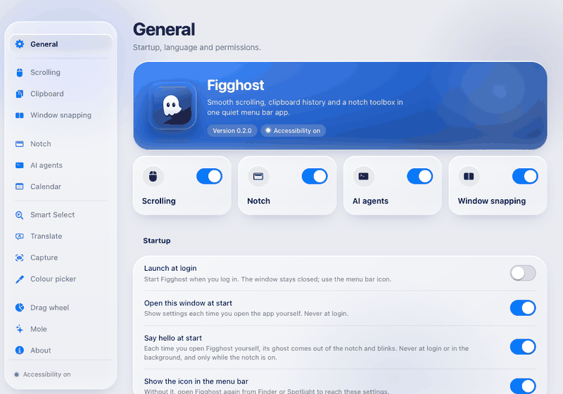

  

<h1 align="center">figghost</h1>

  One native macOS app for the menu bar and the notch: smooth scrolling, clipboard history, window snapping, per-app sound, screenshots and the tools a notch toolbox needs.

  

Figghost is written in Rust with a pure AppKit shell (the `objc2` crates). The settings window is a web page on a Liquid Glass window; every rule behind it lives in tested Rust. It runs in the menu bar, uses about 25 MB with the settings window closed, and is available in English and Vietnamese.

## Contents

- [Highlights](#highlights)
- [Features](#features)
- [Install](#install)
- [Build and run](#build-and-run)
- [Configuration](#configuration)
- [Data and privacy](#data-and-privacy)
- [Technology choices](#technology-choices)
- [Development](#development)

## Highlights

### The notch, with a tab for each tool

A black shape grows out of the top edge of the screen when the pointer reaches it: clipboard, shelf, media, focus, AI agents, calendar and sound, each a tab. Closed, it shows what is playing and what your coding agents are doing.

### A hello from the ghost

Each time you open Figghost yourself, its ghost comes down out of the notch, blinks once and goes back up. Never at login or when it starts in the background, and it can be turned off on the General page. The ghost was drawn with agy; there is also a [video](docs/images/ghost-hello.mp4).

### Window snapping from the notch

Drag a window by its title bar to the top edge and the layouts hang under the notch: halves, thirds, quarters, a wide window beside a narrow one, or a layout you draw from a grid. Point at one and its cells show over the screen; go down into a cell and release to put the window there.

### Smart Select

Select text anywhere and press the shortcut. A small window next to the pointer says what it is: a length in other units, an amount of money in your currencies, a time in other zones, or a translation.

### Drag wheel

Start dragging a file and tap a modifier key: a wheel opens around the pointer with the things that can be done to it (resize, compress, split or merge PDFs, annotate, copy its text, cut out the subject, strip metadata). Drop on a slot to run it.

### A settings window that follows macOS

Liquid Glass, both themes, a page for every feature, and every feature can be turned off on its own page.

## Features

Every picture here is drawn by the app's own code with no screen (`app-ui/settings_preview`, `macos-sys/render_notch`, `render_snap`, `render_smart`, `render_wheel`, `render_hud`, see [docs/development.md](docs/development.md)); the hero image was generated with agy. The GIFs are frames of those renders.

Opening the app opens its settings window; closing the window sends the app back to the menu bar. The features marked "off by default" are switched on in their own page of the settings.

### Scrolling (like Mos)

Smooth mouse-wheel scrolling, a reverse direction for external mice only, modifier keys (sideways, faster, zoom) and per-app rules. The curve drawn in the settings matches what the smoother really does.

### Clipboard history (like Maccy)

Text, links, code, images and files; instant search; pinning with a paste letter; Copy Stack; pinned boards; sensitive data kept out or masked; a popup at the pointer; and an MCP server so an AI assistant can read the history (off by default).

The Shelf tab keeps dropped files as references to where they live. Right-click one to ZIP it, convert it, make it smaller, remove its background or copy the text in the picture.

### Notch panel (like OneNotch)

Seven tabs, window snapping, an optional volume indicator, lyrics, live activities in the closed shape, and a size you choose (compact, standard, wide or custom).

The volume indicator has seven styles, each drawn at three levels:

### AI agents

The Agents tab shows Claude Code and Codex sessions (working, waiting, done), their usage limits with a refresh button, and the tokens and cost at API prices. A permission request from either agent is answered from the notch with Allow or Deny, and the closed notch shows that a question is waiting.

### Window snapping

Layouts per screen, made from presets or from a grid, opened by dragging a window to the top edge.

### Always on top

A shortcut keeps the window in front above all the others, with a red border round it (off by default). macOS lets a program raise only its own windows, so while another window covers the pinned one, a live picture of it is shown over the cover, and a click on the picture brings the real window forward. One window is pinned at a time, from the shortcut or from the switch in the menu bar panel, and the same shortcut lets go of it. Floating windows such as picture in picture stay above it, as the system means them to.

### Cursor

Gives the pointer a look of its own (off by default): a rainbow arrow whose colour turns, one of the six pixel characters of the clipboard mascot that stands, blinks and beams when you point at a link, or any picture, GIF or animated PNG you choose, with its own size, speed and point that clicks. The arrow and the hand over links change; the text cursor stays the system's. The system plays the animation, so nothing runs while the pointer moves. It shows over every other app, and the pointer goes back to normal when you turn it off or quit; if the app is killed, turning the feature off and on again gives the cursors back.

### Sound (like SoundSource and Boom 3D)

Volume to 400 %, mute, output device and equalizer for each app, effects on everything played (equalizer, compressor, limiter), and volume keys for speakers the system cannot turn down.

### Calendar

Today's events and reminders in the notch, and an alert before a meeting with a button that joins the Zoom, Meet, Teams or Webex link (off by default).

### Smart Select and translation

Units, money, times and translation for the selected text (off by default). Rates are one table downloaded once; translation sends at most 450 characters to a public service, and only when you ask for it.

### Capture (like CleanShot X)

Screenshots, scrolling capture, screen recordings (MP4 or GIF, with a key display, the computer's audio and the microphone), an editor, text recognition in Vietnamese and English, and quick action shortcuts after a capture (off by default).

### Colour picker

A loupe on a frozen screen; the colour is copied as HEX, RGB, HSL or HSB (off by default).

### Mole

Checks the health of the Mac and frees disk space with the Mole command line tool (`brew install mole`): caches and leftovers, old build folders, and apps removed with what they left behind. Everything is previewed first and nothing is bundled (off by default).

### And the rest

- Clipboard mascot: a small character that plays a story each time something is copied (off by default).
- Menu bar icons: hide the ones you do not need behind a divider (off by default).
- Dragging a window onto the notch to snap it (off by default).
- Updates: Figghost looks for a new version once a day and asks before it installs; a popup says what is new after an update.

## Install

An Apple silicon Mac with macOS 13 or later. With Homebrew:

    brew tap eliasbui/figghost
    brew install --cask eliasbui/figghost/figghost

Without Homebrew:

    curl -fsSL https://raw.githubusercontent.com/eliasbui/figghost/main/scripts/install.sh | sh

Writing the cask out in full installs it from the tap and trusts only that cask, so no `brew trust` is needed. Both ways put `Figghost.app` in `/Applications` (the script takes `DEST=~/Applications` for somewhere else). The app is signed ad hoc and not notarized, so both remove the quarantine flag after installing it, as other open source notch apps do; build it yourself (below) if you would rather not. `brew uninstall --cask figghost` removes the app, and `--zap` its data in `~/Library/Application Support/Figghost` too. Figghost looks for a new version once a day and asks before it installs one, with what is new in it; with *Update automatically* on in the About page it installs without asking, and *Check now* there does it at once. An update replaces the app where it is, deletes the old copy and the download, and takes effect when Figghost is restarted (the popup has a button for that). It needs to be able to write in the folder the app is in, which an administrator can for `/Applications`; where it cannot, the About page links to the release instead, and running the install command again works as before. Accessibility stays granted through updates, because the app is signed with a name that every build shares; the update from a version that was signed per build asks for it one last time (remove the old Figghost from the list in System Settings, Privacy & Security, Accessibility, then grant it again).

## Build and run

Rust is installed with rustup into `~/.cargo`. Keep the build directory outside the project:

    . "$HOME/.cargo/env"
    export CARGO_TARGET_DIR="$HOME/Library/Caches/figghost-target"
    cargo test --workspace
    cargo clippy --workspace --all-targets -- -D warnings
    scripts/bundle.sh            # creates dist/Figghost.app
    scripts/release.sh 0.2.1     # publishes a release and points the Homebrew cask at it (DRY_RUN=1 to check first)

For development, create a persistent local Code Signing certificate in Keychain Access (for example, `Figghost Local`) and install the watcher once with `cargo install cargo-watch`. Then `SIGN_IDENTITY="Figghost Local" scripts/dev.sh` rebuilds and restarts the local app whenever source files change. The stable identity keeps the Accessibility permission across rebuilds; stop the watcher with Control-C.

Accessibility access is tied to the code signature of the app. The default ad-hoc signature names the app (`vn.figghost.app`) instead of one build, so a rebuild or an update keeps the access that was granted. That is only as strong as the name: a program that signs itself with the same name is let in too. To pin the access to a certificate that nobody else holds, create a local code-signing certificate in Keychain and run `SIGN_IDENTITY="Certificate name" scripts/bundle.sh`; changing from one kind of signature to the other asks for the access once more. `scripts/dev.sh` takes `SIGN_IDENTITY=-` for the ad-hoc one.

Accessibility is needed for smooth scrolling, automatic paste, window snapping, keeping a window on top and the volume indicator. Without it the app still runs: the popup and the notch work, items are copied for a manual paste, and the scroll engine starts by itself once access is granted. Music and Spotify ask once for permission to be read by the media tab.

The app icon is drawn by code: `cargo run -p macos-sys --example make_icon -- X.iconset`, then `iconutil -c icns X.iconset -o crates/app-ui/assets/Figghost.icns`.

## Design

The settings window is a macOS window on Liquid Glass. The sidebar is a glass pane below the window's three buttons, with a field that finds a page by name; the content is glass cards of grouped sections, a label and its control on each row, over a soft backdrop, and the General and About pages open on a hero card in the app's blue. Controls follow the system: they take the accent colour the user chose in System Settings, a state takes its own system colour (green when something is on or granted), buttons are 24 points tall and pop-up buttons and fields 24 or 28, section headers are 13 pt bold, and every icon, in this window and in the menu bar panel, is an SF Symbol drawn by the system. In the notch, text is white at three levels on black, the faintest still 5.3:1; a page shows its key hints only while the notch has the keyboard, and on a screen with a camera cutout the header sits beside the cutout when it fits, so the open shape has no empty band across its top. Only what the user touches moves, briefly for feedback and with springs for things that travel. Contrast was measured, not guessed: text is at least 4.5:1 and the edge of an off control at least 3:1 on the worst backdrops, in both themes. Every effect has a fallback for Reduce transparency, Increase contrast and Reduce motion, focus is always visible, every control has a name, and the whole window works from the keyboard. All tokens are CSS variables at the top of `crates/app-ui/web/app.css`.

## Configuration

`~/Library/Application Support/Figghost/config.json`, written by the settings window. Missing values use defaults, out-of-range values are clamped, and an unreadable file is moved to `config.json.bad` instead of being overwritten. Files written by older versions load unchanged. Every key, every accepted value, and the environment variables and arguments the test instances use are in [docs/configuration.md](docs/configuration.md).

## Data and privacy

History lives in `~/Library/Application Support/Figghost` (`history.sqlite`, an `images` folder, `shelf.json` and the files of the features you turn on), with directory mode 0700 and no encryption. Screenshots and recordings are saved in the folder of macOS's own screenshots (else the Desktop) unless you choose another; the key display of a recording shows shortcuts and keys such as Return, never plain typing. Items flagged by the source app and password managers are skipped, but a password copied from another source can still be stored: use the ignored apps list or clear the history. The settings page is loaded from a string and cannot reach the network. Everything else stays on this Mac.

Apart from the daily look for a new version (one request to api.github.com that carries nothing about you, and the download from github.com when you update), nothing is sent over the network unless you turn it on, and then only what the settings text says: Smart Select downloads a table of exchange rates (nothing about you) and, to translate, sends the selected text (at most 450 characters) to api.mymemory.translated.net; lyrics send the artist, track and album names and the track length to lrclib.net. Both go through the system's curl over https. The refresh button of the usage limits on the Agents tab (Command+R there) runs the Codex program installed on this Mac to ask for its current limits; Codex contacts OpenAI itself, as it does whenever you use it, and Figghost sends nothing and never reads the Codex login. The permissions asked for are Accessibility (shortcuts that act on other apps, the volume indicator, Copy Stack, Smart Select, drag to the notch, keeping a window on top), Screen Recording (screenshots, recordings, the colour picker and the picture of a window kept on top, only when you use them), System Audio Recording (Sound, the first time an app is changed, a recording with the computer's audio, and the bars of the closed notch when they follow the sound), Microphone and Camera (a recording, when turned on in its options), Calendars and Reminders (only when you turn the calendar on) and Automation of Music and Spotify (the Media tab).

## Technology choices

The shell uses AppKit through `objc2`, not GPUI or Tauri. The search field must accept Telex and VNI typing, which `NSSearchField` handles natively. Non-activating panels, mouse tracking and the app lifecycle are proven in this repository, and idle memory stays low. The settings window is a WKWebView because a settings screen with live graphs, glass effects and two languages is far quicker to build and refine as a page, and the page is a thin client: every rule lives in tested Rust. SQLite is the system library (with FTS5 and the trigram tokenizer), not a bundled build.

## Next steps

1. Try the unverified items in [docs/verification.md](docs/verification.md) on real hardware, starting with the ones that need real input or a real screen: Smart Select and screen capture from their shortcuts, the colour picker, Copy Stack, dragging a window to the notch, the menu bar icons, a calendar alert, lyrics with a playing track, physical volume keys, Telex and VNI typing, a notched display, launch at login.
2. From the OneNotch list, what is left: object removal, the system live activities (charging, Bluetooth, Focus), lock screen presence, gestures on the notch and a notch on every display.
3. A Developer ID signature and notarization, which also pins the permissions to a certificate instead of to the app's name.
4. What to take from Raycast and PowerToys, and which of it is possible on macOS from an ad-hoc signed app, is in [docs/research-raycast-powertoys.md](docs/research-raycast-powertoys.md).

## Development

The repository layout, the programs in `crates/*/examples` that check the app, and how to add a language are in [docs/development.md](docs/development.md). What has been verified and what has not is in [docs/verification.md](docs/verification.md).

## License

MIT, see [LICENSE](LICENSE).

The settings window is set in SF Pro, the system's own font, so it reads as the rest of macOS does. Inter is bundled as the fallback for a machine without it, under the SIL Open Font License 1.1: see
[crates/app-ui/assets/Inter-OFL.txt](crates/app-ui/assets/Inter-OFL.txt).
